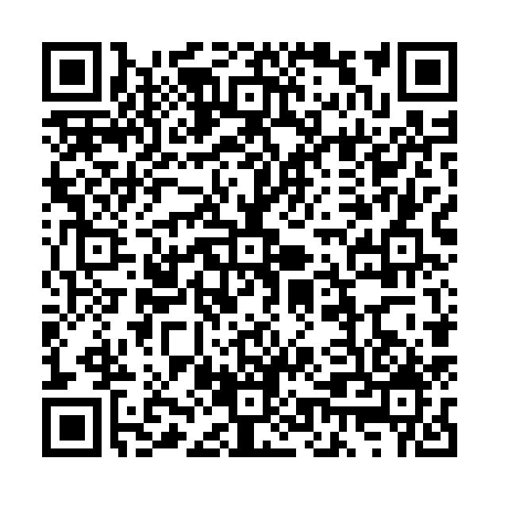

# APK da Feira Tecnológica (sideload)

Este documento descreve como gerar e instalar o APK release assinado do **LensClickApp** para a demonstração da Feira Tecnológica.

## Configuração do app (release)

- **Backend (fonte de verdade):** `https://lensclick.renato-aparecido-business.workers.dev` (produção)
- **Build type:** `release` (`com.lensclick.app`, sem sufixo de aplicação)
- **Distribuição:** sideload (APK instalado diretamente no aparelho) — **não** Google Play nesta fase
- **Assinatura:** release assinado com keystore local/segredo de CI (nunca versionado no Git)

A URL de produção e o `applicationId` estão definidos em `app/build.gradle.kts` no `buildType` `release`.

## Opção A — Gerar pelo GitHub Actions

1. Confirme em **Settings → Secrets and variables → Actions** que a assinatura original da feira está configurada com `ANDROID_KEYSTORE_BASE64`, `ANDROID_KEYSTORE_PASSWORD`, `ANDROID_KEY_ALIAS` e `ANDROID_KEY_PASSWORD`. A assinatura precisa corresponder à do APK publicado para permitir a atualização de uma instalação existente.
2. Em **Actions → Android → Run workflow**, selecione a branch com o código que será distribuído.
3. Aguarde o job **APK assinado da feira**. Ele confere o nome do pacote, o número de versão, o certificado do APK atual e o catálogo incluído no arquivo.
4. Baixe o artefato **lensclick-feira-release-apk** e extraia `app-release.apk`.
5. Abra a release [feira-2026](https://github.com/Renato1909/LensClickApp/releases/tag/feira-2026). Guarde uma cópia do APK anterior e publique o arquivo do job com o nome exato `app-release.apk`. O QR mantém o destino. Confira o download pelo QR e teste a instalação em um aparelho Android.

## Opção B — Gerar localmente (Android Studio / Gradle)

Requer Android SDK instalado (ver `docs/AMBIENTE_ANDROID.md`).

1. **Android Studio:** *Build → Generate Signed Bundle / APK → APK*, selecione a keystore/alias e o build variant `release`.
2. **Linha de comando (Gradle):** informe a assinatura por variáveis de ambiente ou propriedades Gradle (não versionar):

```bash
export LENSCLICK_RELEASE_KEYSTORE_PATH="/caminho/seguro/lensclick-release.jks"
export LENSCLICK_RELEASE_STORE_PASSWORD="***"
export LENSCLICK_RELEASE_KEY_ALIAS="lensclick"
export LENSCLICK_RELEASE_KEY_PASSWORD="***"

./gradlew :app:assembleRelease
```

Saída: `app/build/outputs/apk/release/app-release.apk` (assinado quando as variáveis estão presentes).

Alternativa: passar como propriedades Gradle `-Plensclick.releaseKeystorePath=...`, `-Plensclick.releaseStorePassword=...`, `-Plensclick.releaseKeyAlias=...`, `-Plensclick.releaseKeyPassword=...` ou `-Plensclick.releaseKeystoreBase64=...` (evite expor em histórico de shell).

## Instalação por sideload (aparelho Android)

1. Transfira o `app-release.apk` para o aparelho (USB, Google Drive, e-mail, etc.).
2. No aparelho, permita instalação de **apps de fontes desconhecidas** para o app usado para abrir o APK (Arquivos/Chrome), se solicitado.
3. Abra o APK e confirme a instalação.
4. Abra **Explorar fotógrafos → Perfis da feira** para ver o catálogo de demonstração. Login e busca de perfis reais usam a API de produção.

## QR de instalação

[](https://github.com/Renato1909/LensClickApp/releases/download/feira-2026/app-release.apk)

O QR usa o endereço do APK assinado da release `feira-2026`. Esse endereço permite reutilizar o QR ao disponibilizar uma versão assinada com o mesmo nome de arquivo na release.

### Versão 1.2.1

- Configuração do autenticador pelo QR Code gerado no app, com chave manual e códigos de recuperação.
- Nova tentativa de verificação no mesmo desafio após código incorreto. Desafio expirado solicita novo login.
- Desativação do 2FA com senha e código, seguida de encerramento da sessão local.

## Perfis de apresentação no celular

O menu **Explorar fotógrafos → Perfis da feira** mostra quatro perfis fictícios. Os dados e as fotos vêm dentro do APK, com acesso mesmo sem internet. Os perfis de exemplo ficam em um catálogo separado com bio e portfólio para consulta. No APK de debug, os botões de contratação e orçamento usam os perfis de demonstração carregados no Worker local. O catálogo offline informa que esses perfis ainda não têm avaliações.

## Fotógrafos de apresentação na API local

Com as dependências do LensClick web instaladas e as migrações locais do D1 aplicadas, execute a partir da pasta Android:

```bash
node tools/seed-feira-local.mjs /caminho/para/LensClick-main
```

Inicie o Worker local do projeto web na porta `8787` e abra o APK de debug no emulador. Em **Explorar fotógrafos**, a busca por **São Paulo** mostra Lívia Monteiro (casamentos), Rafael Sato (retratos) e Joana Nascimento (corporativo e retratos). Em **Campinas**, procure Bruno Vidal (eventos). Abra um perfil para apresentar a bio e o portfólio.

O script pode ser repetido e usa o D1 e o R2 locais. Use `--persist-to /caminho/dos/dados-locais` para gravar na mesma pasta de dados usada pelo Worker de desenvolvimento. Os perfis novos são fictícios e servem para demonstrar a busca pública. O APK público do QR conecta ao ambiente de produção.

## Checklist rápido para a demo

- [ ] APK release **assinado** gerado (artefato `lensclick-feira-release-apk` ou `app-release.apk` local).
- [ ] Instala e abre em aparelho real.
- [ ] Aponta para produção (`https://lensclick.renato-aparecido-business.workers.dev`).
- [ ] Os quatro perfis da feira e suas fotos abrem no celular, inclusive com a rede desligada.

## Segurança

- **Nunca** versionar keystore, senhas, tokens ou `local.properties` com segredos.
- `app/build/signing/` (keystore decodificada em build) é gerado em `build/` e já é ignorado; ainda assim, não copie keystores para o repositório.
- Use contas de demonstração na feira; evite expor dados reais e não registre tokens em logs/capturas.
